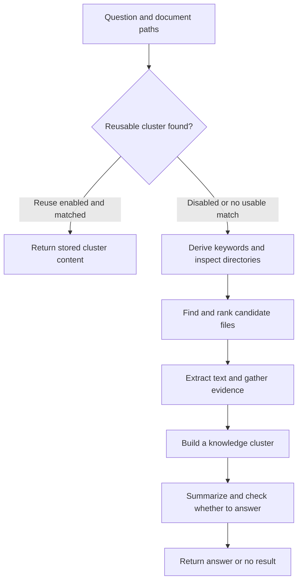

# Test methodology

## Scope and configuration

The campaign uses 81 original documents and the same 120 verified questions in the same order. All runs use DEEP mode and Sirchmunk 0.0.7.

| Run | Evidence-file limit | Cluster reuse | Similarity threshold |
|---|---:|---|---:|
| A | 10 | Off | 0.85 |
| B | 5 | Off | 0.85 |
| C | 10 | On | 0.85 |

Each stage starts with an empty cluster store at `/poc_runs/20261014_ABC_verified120_<A|B|C>/work`. C can reuse only earlier C clusters. Questions run serially; operations within a question can run concurrently.

Exact service settings, container image/digest, and code hashes are recorded in [campaign.json](../poc/results/20261014_ABC_verified120/campaign.json) and each stage's `run_meta.json`. Common limits are ten loops, 128,000 tokens, depth five, and 600 seconds per question. The token setting is not a strict usage cap after parallel work or retries. No seed or temperature override was supplied.

## How DEEP works

In the tested version, DEEP finds relevant files, gathers evidence, and produces an answer. The [runner](../poc/harness/sirch_runner.py) calls `AgenticSearch.search()` with `mode="DEEP"` inside Docker.

The usual retrieval path is:

| Stage | What happens |
|---|---|
| Discover | Derive search terms and inspect directory information and cached search hints. These probes can run in parallel. |
| Retrieve | Use `rga` keyword matches and directory-based selection to find, merge, and rank candidate files. |
| Read evidence | Extract text with `fast_extract()` through Kreuzberg, then examine up to `top_k_files` candidates. Monte Carlo sampling tests text regions and explores promising passages; small files may be read in full. |
| Answer and save | Combine evidence, source references, and a reusable summary into a knowledge cluster. `_summarise_cluster()` produces the response and decisions about answering and saving the cluster. Insufficient evidence can produce a no-result response. |

`top_k_files` limits detailed evidence reading: ten files in A/C and five in B. Keyword search can find more candidates. DEEP therefore does not guarantee reading every page of all 81 documents. Whole-document requests can take a separate direct-analysis route; two questions per stage used that route, with a five-file collection default.

When reuse is enabled, `_try_reuse_cluster()` checks semantic similarity against saved clusters. C uses a threshold of 0.85. A usable match can return stored content before fresh retrieval and sampling. This function checks similarity and nonempty content, without checking whether the document version, issuer, or requested fact still applies. For example, C/XD-10 reused the v1.2 appendix answer for a 2.0 question at similarity 0.994 and returned five instead of eight appendices.

See the [recorded settings](../poc/results/20261014_ABC_verified120/inputs/effective_search_defaults.json), [reuse code snapshot](../poc/results/20261014_ABC_verified120/inputs/cluster_reuse_source.txt), and [reuse cases](../reports/verified120/reuse_cases.csv). The PoC's [scoring and review](EVALUATION.md#scoring-and-review) run after DEEP returns its answer.

## Parsing and search

Original PDF/DOCX/DOC files are copied to `/mnt/docs/S`; no Markdown conversion is used as search input.

| Purpose | Implementation |
|---|---|
| Keyword search | `rga`: Poppler `pdftotext` for PDF; Pandoc for DOCX |
| Candidate reading | `fast_extract()` through Kreuzberg 4.8.2 |
| Evidence selection | Monte Carlo evidence sampling |

All stages share the prewarmed text cache `/poc_cache/rga_S`. Cluster stores remain separate. Parsing prewarm and C's 12.5-second similarity-service preload are outside question timings. No full-corpus vector-chunk index was built; cluster lookup uses semantic similarity.

Every PDF has extractable text. Scanned-only OCR was not tested. The legacy INREV DOC produced 63,927 characters with 240 replacement characters, and `rga` returned a binary match. Its handling remained unchanged across A/B/C. Separately recovered audit text was not substituted into search.

## Execution and evidence

`run_eval.py` invokes `harness/sirch_runner.py` through `docker exec`. The runner calls `AgenticSearch.search()` directly and records answers, candidates, evidence, citations, reuse IDs, gate decisions, timing, usage, and errors. Search receives only IDs and questions. The HTTP API and web UI were not tested.

Two questions per stage took a direct-document route with its own five-file default. CONS-16 consequently missed the ten named RFPs. Usage includes successful service responses from sampling subcomponents; failed calls without returned usage may be uncounted.

## Verification and scoring

Three separate automated review sessions blind-answered 40 questions each before comparing references. Source adjudication supported 109 references, corrected 11, and clarified six question scopes. Initial blind answers remain preserved.

Answers were scored against the frozen reference, supporting passage, and acceptance criteria. Search and scoring used the same configured service, so separate requests may share errors. The required queue covered initially non-correct answers and about 20% of initially correct/refusal answers: 190 records, all resolved. Secondary review withheld the primary label; final decisions remain separate from initial records.

Accuracy is `(correct + correct_refusal) / 120`. Partial, wrong, no-answer, and error cases stay in the denominator. See [workflow and grading](EVALUATION.md) for labels and examples.

## Limits and repairs

- A's Unicode JSONL export was repaired without rerunning search or grading.
- C/SVC-03 recovered from a connection failure; 137.83 seconds and 148,219 tokens remain recorded.
- A/B/C had 5/2/3 serialization recoveries, with no unrecovered runtime errors.
- SVC-15 has an ambiguous audit scope; a separate sensitivity table excludes it.
- File coverage does not establish that the required fact was found. Missing citation traces are reported separately.
- Timings exclude preparation, scoring, review, and export.
- One pass, 15 selected pairs, and nine negative questions do not establish production performance or identical-question replay benefits.
